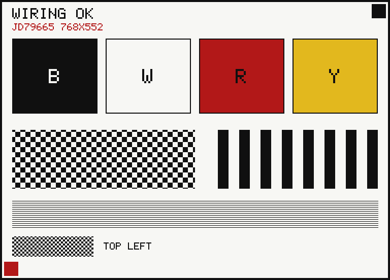

# 墨水屏接线自检固件（AirM2M Core C3 / ESP32-C3）

目的只有一个：**在几十秒内判断八根飞线接对没有**，而不是先做一个完整的图片播放器。
所以它按阶段打串口日志，任何一步失败就停下来，并直接告诉你该查哪根线。

- 屏：`SE0398NZ07-A0/-A1`，控制器 **JD79665AA**，768×552，四色（黑/白/红/黄），2 bit/pixel
- 板：AirM2M Core C3（`board = airm2m_core_esp32c3`，4 MB flash）
- 框架：Arduino，PlatformIO
- 已在 `espressif32 6.13.0` + Arduino core 2.0.17 上编译通过：RAM 4.3%，Flash 19.2%，零警告



> 上图由 `tools/preview_wiring_test.py` 直接解析 `src/main.cpp` 的版面常量与字库渲染，
> 改了固件这张图会跟着变，不会和代码说两套话。

## 接线（就是这张表，改线只改 `src/main.cpp` 顶部六个宏）

| 屏 | ESP32-C3 | 本固件宏 |
|---|---|---|
| 3.3V | 3V3 | — |
| GND | G | — |
| SDA / DIN | GPIO6 | `PIN_EPD_MOSI` |
| CLK / SCK | GPIO4 | `PIN_EPD_SCK` |
| DC | GPIO1 | `PIN_EPD_DC` |
| CS | GPIO7 | `PIN_EPD_CS` |
| RST | GPIO2 | `PIN_EPD_RST` |
| BUSY | GPIO10 | `PIN_EPD_BUSY` |

屏是**只写**设备，没有 MISO，所以不要接 DOUT，也别指望能读回寄存器。

## 烧写

```powershell
cd firmware/epd-wiring-test
pio run -t upload
pio device monitor        # 115200
```

首次 `pio run` 会下载 espressif32 平台；之后都是增量编译，几秒钟。
如果串口一直在刷乱码，确认 `monitor_speed = 115200`——本板用 USB CDC，
`ARDUINO_USB_MODE=1`，监视器里看到的应该是纯文本。

## 怎么判读

正常情况（约 2 秒内走完前 5 步，最后一步等 15~25 秒）：

```
[1/6] BUSY 空闲采样：32 次里 32 次为高（1=空闲）
[2/6] 硬复位：RST 高 20ms -> 低 10ms -> 高 20ms
      复位后 BUSY: 先忙后闲 = 正常（37 ms）
[3/6] 写初始化寄存器表（14 条）
[4/6] 准备上电并刷第一页
      PON 后 BUSY: 先忙后闲，耗时 12 ms
      传图完成：600 行 x 200 字节 = 120000 字节，用时 118 ms
      DRF 后 3 ms 内 BUSY 拉低（开始刷新）
      刷新结束，用时 18342 ms
  ok 画面应已更新
```

### 失败点 → 该查什么

| 日志 | 含义 | 优先检查 |
|---|---|---|
| `[1/6]` 里 32 次只有一部分为高 | BUSY 引脚浮空或接触不良 | `BUSY → IO10` 的焊点、杜邦线 |
| `复位后 BUSY: 一直空闲` | 控制器没被复位，或根本没上电 | `3V3`、`GND`、`RST → IO2`；万用表量 RST 有没有真的被拉低 10 ms |
| `BUSY 一直是低` | BUSY 被短路到 GND，或屏没电 | 万用表量 `BUSY` 对 `GND` 的阻值 |
| `PON 没有正常完成` | 升压没起来 | 供电是否够（3.3 V 要能吃下几百 mA 峰值）、`BUSY`、`RST` |
| `DRF 后 8000 ms 内 BUSY 没有拉低` | **控制器没收到有效 SPI**（最常见） | `DC→IO1`、`CS→IO7`、`SCK→IO4`、`DIN→IO6` 逐个量通断；尤其 `CS` 和 `DC` 接反最容易犯 |
| 有画面但整体偏移/半屏 | 数据通了但传输几何不对 | 先降到 `EPD_SPI_HZ 4000000` 重试，仍不对再查屏型号 A0/A1 |
| 画面 180° 旋转 | 扫描方向 | 打开 `main.cpp` 里的 `EPD_PSR_FLIP_ENABLE` |
| 只有部分颜色对 | 2bpp 编码或行列错位 | 看预览图里四色块的相对位置；错位通常是 CS 时序 |

### 串口命令

```
p = 测试图     b = 全黑     w = 全白     c = 依次循环
```

`c` 用来确认屏**能反复改写**（不是只出了一次图就死）。四色全刷一次约 20 秒，
中途断电会留下残影，属正常现象。

## 设备树之外的三条硬约束

1. **SPI 别一上来就冲高**：参考实现是 10 MHz，但如果杜邦线比较长（>10 cm），
   先降到 4 MHz 排掉线材因素，能稳定出图再往上加。
2. **BUSY 高 = 空闲**。JD79665 的极性是「低=忙」，别按常见传感器「低有效」的直觉改反。
3. **可见区只有 768×552，但必须传 800×600**。控制器帧存是固定 800×600×2bit，
   可见图像放在 `(32, 0)`，其余补白。少传一行都会让整帧错位。

## 许可说明

寄存器序列来自公开的社区实现（`panyihang/3.98Inch-ESP32C3-EPD`、
`openepaperlinkforCN` 的 `EPD_3in98g`、以及 `jd79665` 生产驱动）。
那几个仓库**都没有 LICENSE**，因此这里只借鉴了寄存器取值（硬件事实），
代码结构、驱动分层、测试图与字库均为本仓库自行编写。
